# Minikanban

A small Mac board for tracking issues across the modules or areas of a project. It lives in your menu bar, opens as a window, and comes with a desktop widget.

- Add issues and edit the title and description right on the card
- Tag each issue with a module, and change the tag any time
- Give each issue a priority by clicking its icon: low (blue), medium (purple), high (red)
- Module tiles show a gradient of their open issues' priority colours, so busy modules stand out
- Mark issues complete to hide them; turn on **Show completed** to see them again
- Progress bars for every module and overall
- Drag a card onto another column to move it between To do, In progress and Done
- Collapse or expand the To do, In progress and Done columns by clicking their headers
- Desktop widget with your top 5 high-priority issues (or the next 5 open ones), which you can tick off from the widget
- Light, dark, or match the system (gear button, bottom right)

## Installing

### Homebrew (recommended)

```bash
brew install --cask bananacoffeecode/tap/minikanban
```

### Install script

Paste this in Terminal. It downloads the latest release, removes the macOS quarantine flag, moves the app to Applications and opens it:

```bash
curl -fsSL https://raw.githubusercontent.com/bananacoffeecode/minikanban/main/install.sh | bash
```

### Manual

1. Download `Minikanban.zip` from the [Releases](../../releases) page and unzip it
2. Drag **Minikanban** into your Applications folder
3. If macOS blocks it, right-click the app → **Open** → **Open**, or go to **System Settings → Privacy & Security** and click **Open Anyway**

## Using it

- **Menu bar:** click the checklist icon. If you can't see it, your menu bar may be full or the icon may be behind the notch; check **System Settings → Menu Bar**.
- **Window:** the board also opens in a window at launch and lives in the Dock.
- **Widget:** right-click the desktop → **Edit Widgets…** → search for **Minikanban**.
- **Modules:** click a module's name to rename it, click elsewhere on the tile to filter, and hover for × to delete it.

Your board is saved on your Mac in `~/Library/Application Support/Minikanban/board.json`. It isn't synced between people or devices.

## What's here

- `minikanban.html`: the board's interface, which the app displays
- `install.sh`: the install script above
- `PRD.md`: the product spec
